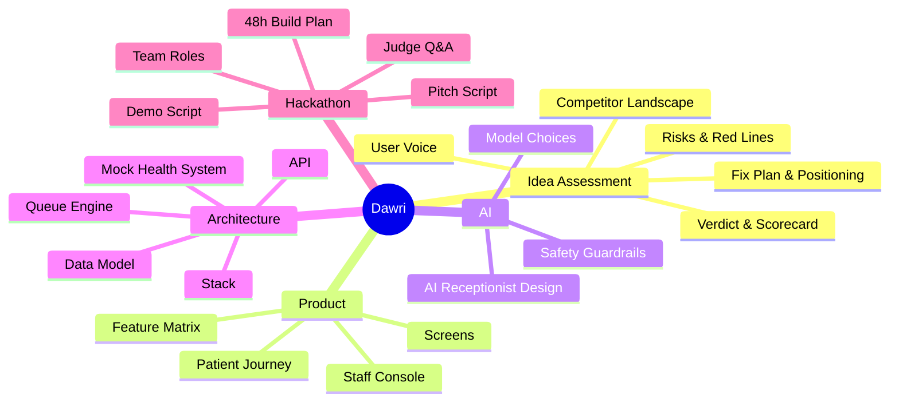

# 🏥 Dawri (دوري) — "Arrive, don't register"

> *Dawri* = "my turn" in Arabic. Health centres first; the same core is meant to expand to other government service queues → [[Vision - Dawri Platform]]

**One line:** An AI front desk for Qatar's health centres. The patient checks in from their phone in Arabic or English, an open-source model on Hugging Face does the intake, and the patient walks straight into the existing queue — triage → doctor → pharmacy — without stopping at reception.

## Start here
1. [[01 Enhanced Prompt]] — the cleaned-up, corrected version of our idea (paste this into Claude Code / give to the team)
2. [[Verdict & Scorecard]] — is the idea good? (short answer: yes, if we scope it right)
3. [[48h Build Plan]] — what to build, hour by hour, before Saturday 5 PM

## Map of the vault

### 02 Idea Assessment
- [[Verdict & Scorecard]]
- [[Competitor Landscape]]
- [[User Voice (Reviews)]]
- [[Fix Plan & Positioning]]
- [[Risks & Red Lines]]

### 03 Product
- [[Patient Journey]]
- [[Screens]]
- [[Feature Matrix]]
- [[Staff Console]]

### 04 AI
- [[AI Receptionist Design]]
- [[Model Choices]]
- [[Safety Guardrails]]

### 05 Architecture
- [[Stack]]
- [[Data Model]]
- [[API]]
- [[Mock Health System]]
- [[Queue Engine]]

### 06 Hackathon
- [[48h Build Plan]]
- [[Team Roles]]
- [[Demo Script]]
- [[Pitch Script]]
- [[Judge Q&A]]

### Reference
- [[Sources]]
- [[Open Questions]]

## Which Replica skills were used
| Skill | Used? | What it produced here |
|---|---|---|
| replica-entrepreneur | ✅ | Competitor research, real user complaints, fix plan, positioning → [[Competitor Landscape]], [[User Voice (Reviews)]], [[Fix Plan & Positioning]] |
| replica-recon | ✅ (adapted) | Screens, flows, feature matrix, data model — for our product, since there is no single app to clone → [[Screens]], [[Feature Matrix]] |
| replica-architect | ✅ | Stack, SQL schema, API routes, vertical-slice build order → [[Stack]], [[Data Model]], [[API]] |
| replica-design / build / test | ⏭ later | Run during the build itself |
| replica-brand / launch / deploy | ❌ | Store listings and production deploy don't matter for a 48-hour demo |
