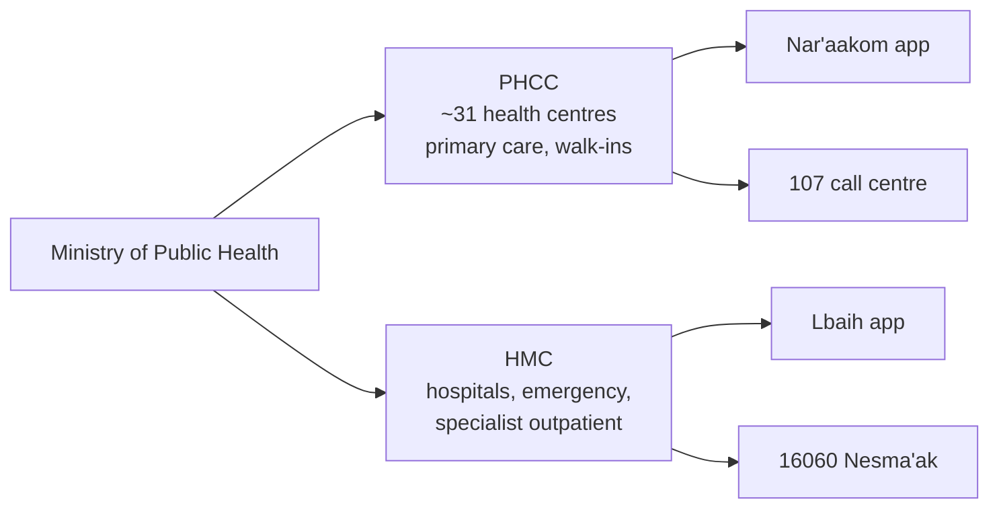
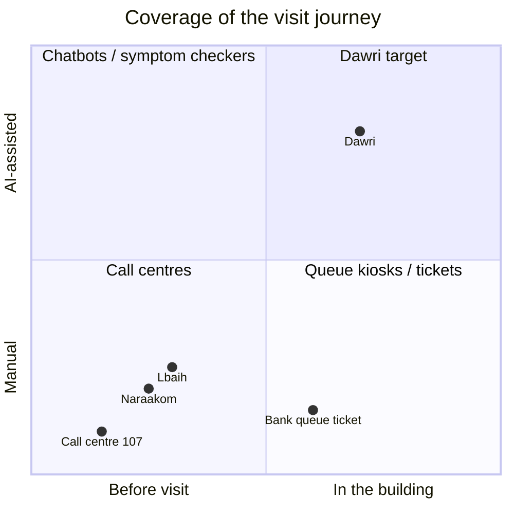

# Competitor Landscape

> Researched 5 Nov 2026 from public news, official pages and store listings. Re-check at kickoff if a mentor says something new shipped.

## Who runs what (important correction)

Our original idea said "health centres by Hamad". Health centres are **PHCC**. Hamad (HMC) runs the hospitals. Both log in with Qatar's national authentication (Tawtheeq).

## Existing products

| Product | Owner | What it does | What it does NOT do (as far as public info shows) |
|---|---|---|---|
| **Nar'aakom** | PHCC | Health card view/renew, assigned centre & family doctor, change centre/doctor, request & manage appointments, dependents | Remote check-in for walk-ins, live queue position, pre-visit intake, AI |
| **Lbaih** | HMC (launched July 2025, 300k+ downloads by July 2026) | Appointments (view, reschedule, cancel, confirm within 48h), medical file, labs, radiology reports, vitals, prescriptions, e-payment at 3 hospitals | Walk-in check-in, triage intake, live queue, AI |
| **107 / 16060 call centres** | PHCC / HMC | Book, change, cancel appointments by phone | Anything live in the building |
| **WhatsApp refill line** | PHCC | Medication refill + home delivery via the centre's WhatsApp number | Not connected to a visit flow — we can route refill requests to it |
| **QNB app queue ticket** | QNB (bank) | Check branch wait, take a queue ticket in the app | Proof that Qatar residents already use mobile queue tickets — good analogy for the pitch |

## The numbers that make the case
From PHCC's **Annual Snapshot 2025** (reading the table layout of the PDF — double-check the slide before quoting on stage):
- **Walk-in visits ≈ 69%**, appointment visits ≈ 31%
- **No-show rate ≈ 29%** for appointments
- **Wait for an appointment ≈ 14 days**
- Virtual consultations ≈ 9%

Meaning: most patients don't book — they walk in and queue at reception. Appointments are hard to get quickly, and many booked slots go unused. Dawri targets exactly the walk-in path and adds an arrival-activated ticket that releases unused places.

Other signals:
- A 2026 Reddit thread (r/qatar snapshot) complains health centres now discourage walk-ins unless it's urgent — access is a live pain point.
- Long-running press coverage of crowded centres (Al Wakra, Mesaimeer) and PHCC's own satisfaction survey ranked waiting time lowest among the areas measured (2014).
- HGH Emergency improved median wait to see a doctor to ~15–25 minutes (2024) — emergencies are not our target; we route them out.

## Where Dawri sits

## Worldwide (so we don't overclaim)
Virtual queues, mobile check-in and AI pre-visit intake exist in other health systems and in generic queue products. Our novelty is the **Qatar combination**: PHCC walk-in flow + Arabic/Khaleeji voice + Qatar's Fanar model + arrival-activated tickets + nurse handoff. Say "first for Qatar's walk-in front desk", not "first in the world".

Related: [[User Voice (Reviews)]] · [[Fix Plan & Positioning]]
