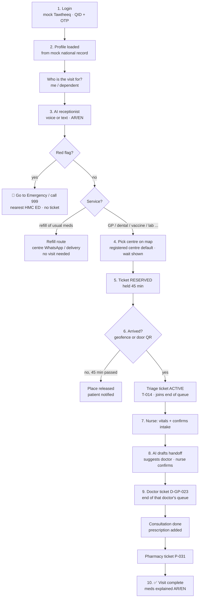

# Patient Journey

## The whole visit at a glance

## Step by step (enhanced)

| # | Step | Patient sees | System does | AI involved? |
|---|---|---|---|---|
| 1 | Login | "Log in with Tawtheeq (demo)" → QID → OTP | Mock auth; issues session | No |
| 2 | Profile | Name, age, registered centre, dependents. Banner: *Demo data* | Fetches synthetic record from [[Mock Health System]] | No |
| 3 | Receptionist chat | Mic button + chat; transcript shown to confirm | Whisper → text; red-flag rules; Fanar asks 3–6 questions; produces intake JSON | **Yes** |
| 3a | Red flag | Full-screen red card, call 999 button, nearest ED on map | Visit logged as `redirected_emergency`; no ticket | Rules first, model second |
| 3b | Refill | "You can get this without a visit" → open centre's refill channel | Visit closed as `deflected_refill` | Yes (classification) |
| 4 | Centre | Map pins with wait estimates; registered centre highlighted | Wait = people ahead × avg service time | Suggestion text only |
| 5 | Reserve | "Your place is held for 45 min" + countdown | Ticket `RESERVED` | No |
| 6 | Arrive | Big number T-014, people ahead, est. wait, "go to triage area" | Geofence/QR → `ACTIVE`, appended to end | No |
| 7 | Triage | "Nurse is calling T-014" (+ display screen) | Nurse console shows intake; vitals form | Intake shown |
| 8 | Handoff | "Next: Dr. room 4 — D-GP-023" | AI drafts summary + doctor suggestion; nurse confirms | **Yes** (draft only) |
| 9 | Doctor | Live position in doctor queue | Doctor marks done, picks prescription | Summary shown |
| 10 | Pharmacy & done | Pharmacy ticket → "Visit complete", meds in plain language | Visit `COMPLETED`; timestamps for stats | Plain-language med text |

## Three demo patients (see [[Mock Health System]])
1. **Fatima, 34** — Arabic voice: fever + cough for 3 days → full flow to pharmacy.
2. **Ahmed, 67** — "I need my usual blood pressure tablets" → refill deflection.
3. **Ravi, 45** — English: chest pain spreading to left arm → emergency screen.

Related: [[Screens]] · [[Queue Engine]] · [[AI Receptionist Design]]
