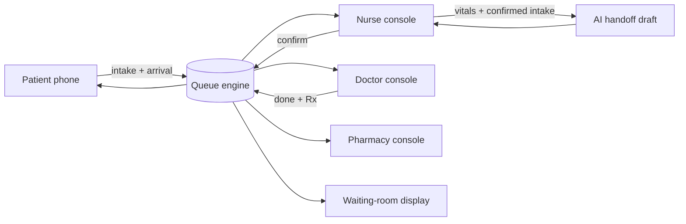

# Staff Console

The demo is only believable if judges see **both sides** of the queue update live. Open the patient app on a phone and the nurse console on a laptop side by side.

## Roles


## Nurse intake card (T03) — what the AI pre-fills
```
T-014 · Fatima A. · F · 34 · arrived 10:42 · waiting 6 min
──────────────────────────────────────────────
Reason (AI, editable):  Fever and dry cough, 3 days
Severity (patient):     6/10
Fever:                  yes, max ~38.5 °C (patient report)
Meds taken:             paracetamol
Allergies (record):     penicillin ⚠
Chronic (record):       none
Red flags checked:      none detected
Suggested service:      GP
──────────────────────────────────────────────
Vitals: BP [   /   ] HR [  ] Temp [   ] SpO₂ [  ] Wt [  ]
Urgency (nurse decides): ○ routine ○ soon ○ urgent→ED
[ Edit ]  [ Confirm & generate handoff ]
```

## Handoff (T04) — AI draft, nurse confirms
- 3–5 line clinical summary in English (doctor's language), Arabic available.
- Suggested doctor: same clinic type, shortest queue, language match, gender preference if the patient set one.
- Shows **why** ("Dr. Noor — GP, 2 waiting, speaks Arabic") and the alternatives with their queue length.
- Nurse can pick another doctor. Nothing is sent without "Confirm".

## Doctor (T05)
- Queue + handoff card + vitals. Buttons: **Done**, prescription picker (demo list), "Refer to lab/X-ray" (Could).

## Display (T08)
Big numbers per counter, Arabic + English, chime on change. Classic waiting-room look — instantly recognisable to judges from Qatar.
