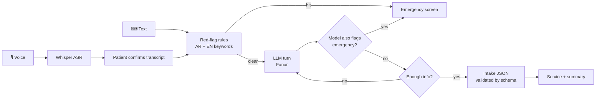

# AI Receptionist Design

## Pipeline


## The conversation
Max **6 questions**. Short, warm, one question at a time. Matches the patient's language and dialect.

1. "What brings you in today?" / "شو اللي يتعبك اليوم؟"
2. "Since when?"
3. "How bad is it from 0 to 10?"
4. Follow-up based on complaint (fever? where is the pain? any vomiting?)
5. "Did you take any medicine for it?"
6. "Anything else the nurse should know?"

Then: shows the summary back → "Is this right?" → patient confirms or corrects.

## System prompt (starting point)
```text
You are the reception assistant at a Qatar primary health centre. You help
patients check in before they arrive. You are NOT a doctor or nurse.

Rules:
- Never diagnose, name a likely condition, suggest treatment or doses.
- Ask one short question at a time, max 6 questions in total.
- Reply in the patient's language and dialect (Gulf Arabic, MSA or English).
- If anything suggests an emergency (chest pain, trouble breathing, stroke
  signs, severe bleeding, fainting, severe allergic reaction, thoughts of
  harming themselves, a very sick baby) output {"emergency": true} and stop.
- When you have enough information, output ONLY the intake JSON.
- Use the patient record you are given for allergies and chronic
  conditions; don't ask for what the record already has.

Patient record: {{record_json}}
```

## Intake JSON schema
```json
{
  "emergency": false,
  "language": "ar-gulf",
  "chief_complaint": "fever and dry cough",
  "chief_complaint_patient_words": "عندي حرارة وكحة من ثلاث أيام",
  "duration": "3 days",
  "severity_0_10": 6,
  "associated": ["fever"],
  "self_medication": ["paracetamol"],
  "service": "gp",
  "service_confidence": 0.86,
  "summary_for_nurse": "34F, 3 days fever and dry cough, severity 6/10, took paracetamol.",
  "refill_request": null,
  "questions_asked": 5
}
```
Validate with Pydantic. If invalid → retry once with the error message → else fall back to "front desk will help you" (never block the patient).

`service` enum: `gp | dental | refill | vaccination | lab_only | womens_health | mental_health | other`

## Handoff prompt (nurse → doctor)
Input: confirmed intake + vitals + record. Output: 3–5 line English summary in a fixed order (who · complaint & duration · relevant history & allergies · vitals · patient concerns). No differential diagnosis.

## Doctor suggestion — keep it rules, not AI
```
candidates = doctors on shift in clinic == service
score = queue_length*1.0 + (0 if language_match else 2) + (0 if gender_pref_ok else 5)
suggest = min(score); show top 3 with reasons
```
The AI only writes the human-readable reason. This keeps "AI assigns a doctor" explainable and safe. See [[Safety Guardrails]].

## Plain-language medicines (visit complete)
Input: prescription list. Output: one line per medicine in the patient's language ("Take 1 tablet after food, 3 times a day, for 5 days") **copied from the prescription fields**, not invented by the model. The model only translates/simplifies.
