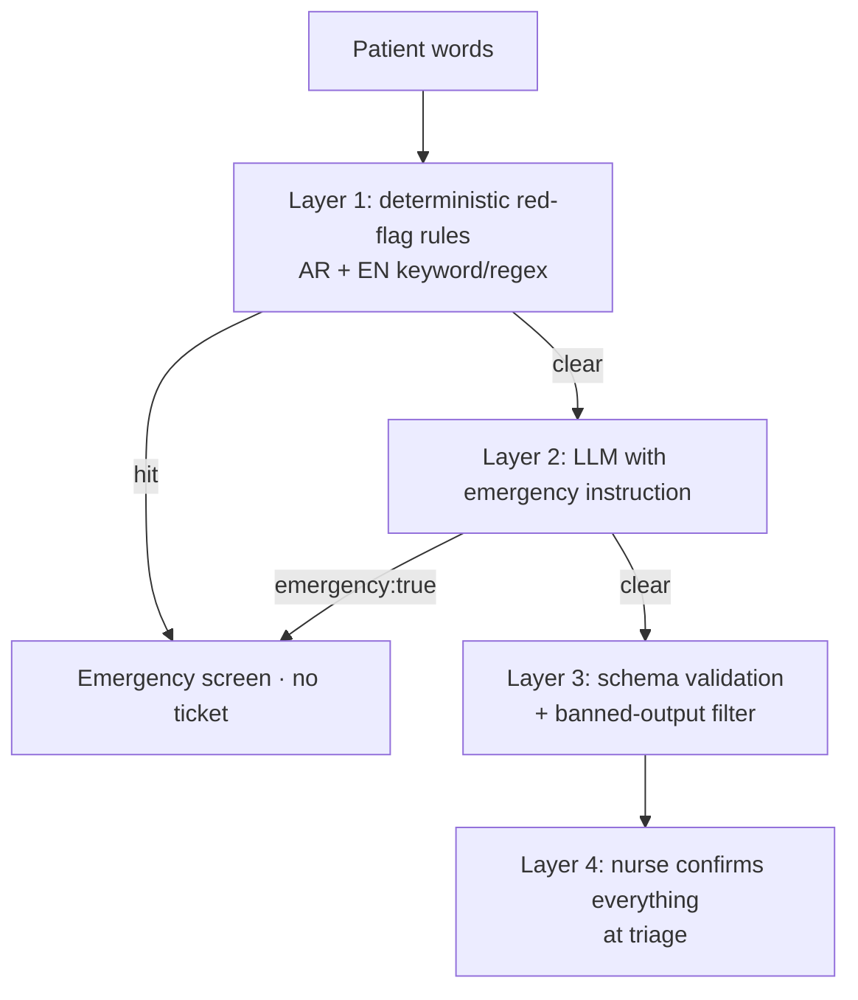

# Safety Guardrails

## Layered safety

A layer can only make things **more cautious**, never less. The model can't overrule Layer 1.

## Red-flag starter list (extend with a clinician mentor if available)
| Category | English cues | Arabic cues (MSA + Gulf) |
|---|---|---|
| Chest pain | chest pain, pressure in chest, pain to left arm/jaw | ألم في الصدر، ضيقة في الصدر، يوجعني صدري |
| Breathing | can't breathe, short of breath, choking | ما أقدر أتنفس، ضيق تنفس، اختناق |
| Stroke | face drooping, can't move arm, slurred speech | وجهي مايل، ما أقدر أحرك يدي، كلامي ثقيل |
| Bleeding | heavy bleeding, vomiting blood | نزيف، أستفرغ دم |
| Consciousness | fainted, passed out, seizure | أغمى علي، تشنج |
| Allergy | throat swelling, lips swelling | انتفاخ الحلق، تورم الشفايف |
| Pregnancy | bleeding while pregnant, severe pain pregnant | نزيف وأنا حامل |
| Infant | baby not feeding, baby very sleepy, baby with high fever | الطفل ما يرضع، حرارة عالية للرضيع |
| Self-harm | want to hurt myself, end my life | أبي أأذي نفسي |

For self-harm cues, the emergency screen shows emergency (999) **and** a supportive message to talk to someone now — not a queue.

## Banned outputs (filter after generation)
- Disease names presented as the patient's condition ("you have…", "عندك…")
- Drug names + doses not already in the patient record or prescription
- Any queue position/number generated by the model (numbers come only from the queue engine)

## Human-in-the-loop points
| Decision | Who decides |
|---|---|
| Is it an emergency? | Rules + model can only escalate; nurse at triage decides urgency |
| Which service | AI suggests; patient confirms; nurse can change |
| Which doctor | Rule score suggests; nurse confirms |
| Queue order | Queue engine only (arrival + centre priority rules) |
| Medicines | Doctor only |

## Privacy (for the judges)
- Synthetic patients only (see [[Mock Health System]]).
- Collect the minimum: no free-text storage beyond the visit; audio not stored after transcription.
- Consent screen before the first chat.
- Production story: deploy inside Qatar (on-prem or a sovereign cloud), open models → no patient data sent to foreign APIs. Qatar's personal data protection law treats health data as sensitive — compliance review with PHCC/MoPH is phase 2.
