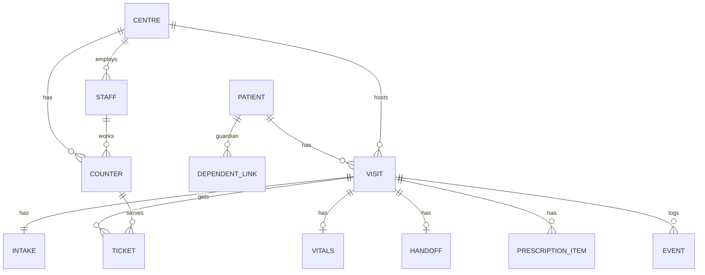

# Data Model



## SQL (SQLite)
```sql
CREATE TABLE patient (
  id            TEXT PRIMARY KEY,          -- 'P001'
  qid_demo      TEXT UNIQUE NOT NULL,      -- fake, e.g. 'DEMO-28934' (never real)
  full_name_en  TEXT, full_name_ar TEXT,
  dob           TEXT, sex TEXT CHECK (sex IN ('F','M')),
  preferred_lang TEXT DEFAULT 'ar',
  registered_centre_id TEXT REFERENCES centre(id),
  allergies     TEXT,                      -- JSON array
  chronic       TEXT,                      -- JSON array
  active_meds   TEXT                       -- JSON array
);

CREATE TABLE dependent_link (guardian_id TEXT, dependent_id TEXT,
  PRIMARY KEY (guardian_id, dependent_id));

CREATE TABLE centre (
  id TEXT PRIMARY KEY, name_en TEXT, name_ar TEXT,
  operator TEXT CHECK (operator IN ('PHCC','HMC')),
  lat REAL, lng REAL, services TEXT,       -- JSON array of service codes
  has_emergency INTEGER DEFAULT 0
);

CREATE TABLE staff (
  id TEXT PRIMARY KEY, centre_id TEXT REFERENCES centre(id),
  name TEXT, role TEXT CHECK (role IN ('nurse','doctor','pharmacist','desk')),
  clinic TEXT, languages TEXT, gender TEXT
);

CREATE TABLE counter (                     -- a queue point
  id TEXT PRIMARY KEY, centre_id TEXT, stage TEXT
    CHECK (stage IN ('triage','doctor','pharmacy')),
  label TEXT,                              -- 'Triage 1', 'Room 4'
  staff_id TEXT REFERENCES staff(id),
  prefix TEXT,                             -- 'T', 'D-GP', 'P'
  avg_service_sec INTEGER DEFAULT 420
);

CREATE TABLE visit (
  id TEXT PRIMARY KEY, patient_id TEXT REFERENCES patient(id),
  centre_id TEXT REFERENCES centre(id),
  status TEXT CHECK (status IN ('intake','redirected_emergency','deflected_refill',
     'reserved','expired','in_triage','in_doctor','in_pharmacy','completed','cancelled')),
  service TEXT, created_at TEXT, arrived_at TEXT, completed_at TEXT
);

CREATE TABLE intake (visit_id TEXT PRIMARY KEY REFERENCES visit(id),
  json TEXT NOT NULL, transcript TEXT, confirmed_by_patient INTEGER DEFAULT 0,
  edited_by_staff_id TEXT, edited_json TEXT);

CREATE TABLE ticket (
  id TEXT PRIMARY KEY, visit_id TEXT REFERENCES visit(id),
  counter_id TEXT REFERENCES counter(id), number TEXT,   -- 'T-014'
  seq INTEGER,                              -- order within counter/day
  priority INTEGER DEFAULT 0,               -- set ONLY by centre rules
  state TEXT CHECK (state IN ('reserved','active','called','serving','done','released')),
  reserved_at TEXT, activated_at TEXT, called_at TEXT, done_at TEXT
);
CREATE INDEX ix_ticket_queue ON ticket(counter_id, state, priority DESC, seq);

CREATE TABLE vitals (visit_id TEXT PRIMARY KEY, bp_sys INT, bp_dia INT, hr INT,
  temp_c REAL, spo2 INT, weight_kg REAL, urgency TEXT, nurse_id TEXT, at TEXT);

CREATE TABLE handoff (visit_id TEXT PRIMARY KEY, ai_draft TEXT, final_text TEXT,
  suggested_doctor_id TEXT, chosen_doctor_id TEXT, reason TEXT,
  confirmed_by TEXT, at TEXT);

CREATE TABLE prescription_item (id INTEGER PRIMARY KEY AUTOINCREMENT,
  visit_id TEXT, drug TEXT, dose TEXT, frequency TEXT, days INT, notes TEXT);

CREATE TABLE event (id INTEGER PRIMARY KEY AUTOINCREMENT, visit_id TEXT,
  type TEXT, payload TEXT, at TEXT);       -- audit trail for every AI + staff action
```

The `event` table doubles as the "AI is auditable" proof for judges.
