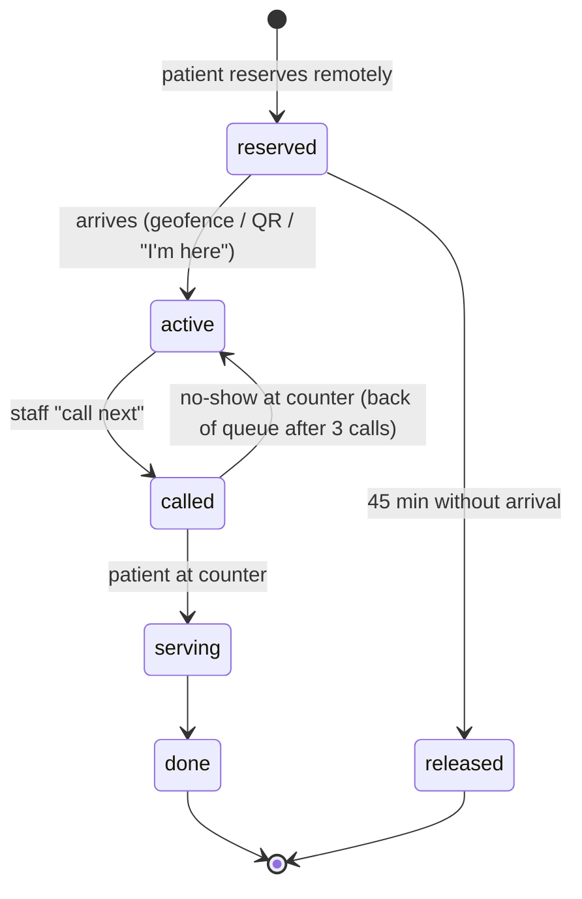

# Queue Engine

Deterministic. No AI inside. This is what makes "nobody skips anyone" true.

## Ticket lifecycle


## Rules
1. **Reserving does not give a place.** A place in line is created at `activated_at` (arrival). So someone at home cannot get ahead of someone already in the waiting room.
2. **New stage = end of that stage's queue.** After triage, the doctor ticket gets the next `seq` for that doctor's counter. No jumping.
3. **Priority comes only from centre rules**, e.g. `priority=1` for 65+, disability, late pregnancy — configured per centre, never by the model. Within a priority level: arrival order.
4. **Nurse "urgent→ED"** ends the visit queue and routes to emergency (outside our queue).
5. **Numbers follow the centre's format** (`T-014`, `D-GP-023`, `P-031`), reset daily.
6. **Released places free capacity** — addresses the no-show problem.

## Ordering query
```sql
SELECT * FROM ticket
WHERE counter_id = :c AND state = 'active'
ORDER BY priority DESC, activated_at ASC, seq ASC
LIMIT 1;
```

## Wait estimate (simple, explainable)
```
people_ahead = count(active|called tickets ahead in order)
est_wait_min = people_ahead * counter.avg_service_sec / 60 / max(1, staff_on_counter)
```
`avg_service_sec` = rolling mean of the last 20 `done_at - called_at` at that counter (seed: triage 4 min, GP 8 min, pharmacy 3 min).

For the centre map: show triage wait + typical doctor wait for the chosen service.

## Integration path (pitch)
`adapters/queue_base.py` defines `issue_ticket()`, `activate()`, `call_next()`. Our SQLite engine is one implementation; a real deployment adds an adapter to whatever queue/ticketing system the centre already runs.
