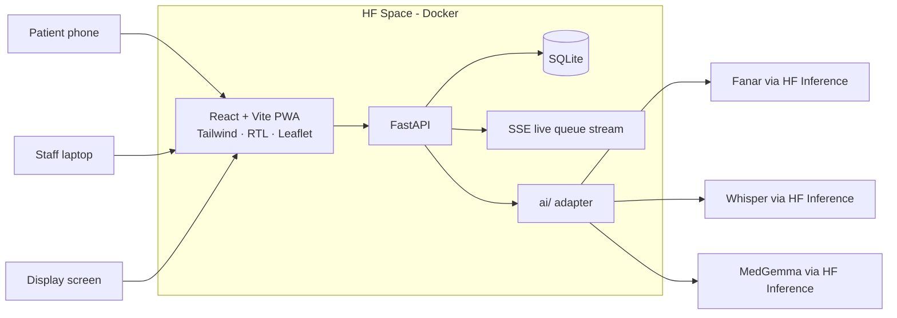

# Stack

Boring, fast, one deploy target.



| Layer | Choice | Why |
|---|---|---|
| Frontend | React + Vite + Tailwind (`dir="rtl"` switch), Leaflet + OpenStreetMap tiles | Team likely knows JS; Leaflet needs no API key |
| Backend | FastAPI (Python) | Same language as HF tooling; async; auto docs at `/docs` |
| DB | SQLite (file in the Space) | Zero setup; enough for a demo. Swap to Supabase/Postgres if the team prefers |
| Live updates | Server-Sent Events | Simpler than WebSockets, one-way is all we need |
| AI | `huggingface_hub.InferenceClient` | One client for chat, ASR |
| Deploy | Hugging Face Space, **Docker SDK** | Meets "live demo on HF"; one URL for everything |

## Repo layout
```
dawri/
├─ backend/
│  ├─ main.py            # FastAPI app, serves /api + built frontend
│  ├─ db.py  models.py   # SQLite + schema
│  ├─ queue_engine.py    # see [[Queue Engine]]
│  ├─ mock_health.py     # see [[Mock Health System]]
│  ├─ ai/ llm.py asr.py intake.py redflags.py handoff.py
│  └─ seed/ patients.json centres.json doctors.json
├─ frontend/
│  └─ src/ pages/patient/* pages/staff/* components/* i18n/{ar,en}.json
├─ Dockerfile
└─ README.md            # HF Space card
```

## Dockerfile (single container)
```dockerfile
FROM node:20 AS fe
WORKDIR /fe
COPY frontend/ .
RUN npm ci && npm run build

FROM python:3.11-slim
WORKDIR /app
COPY backend/ ./backend
RUN pip install --no-cache-dir fastapi uvicorn[standard] pydantic huggingface_hub sse-starlette
COPY --from=fe /fe/dist ./backend/static
ENV PORT=7860
CMD ["uvicorn", "backend.main:app", "--host", "0.0.0.0", "--port", "7860"]
```
Set `HF_TOKEN`, `LLM_MODEL_ID`, `ASR_MODEL_ID` as **Space secrets**.
