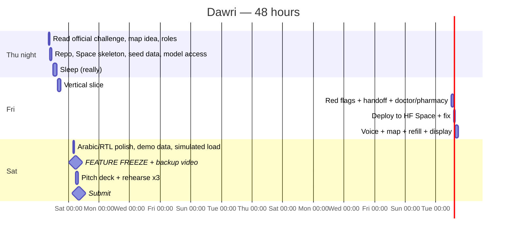

# 48h Build Plan

Kickoff: **Thu 5 Nov, 5:00 PM** · Submission: **Sat 7 Nov, 5:00 PM** · Venue: Nestwork Msheireb (M7)

## Tonight (Thu) — checklist
- [ ] Read the official challenge text dropped at kickoff. Does "AI system that solves a real problem in Qatar" match? Write our one-line mapping to it.
- [ ] Assign [[Team Roles]].
- [ ] Ask HF mentors: inference credits / GPU for Fanar-27B? Gated access for MedGemma?
- [ ] Create HF org/Space (Docker), repo, `.env` with `HF_TOKEN`.
- [ ] Test one Fanar chat call + one Whisper call from a notebook. **If either fails, pick the fallback now** ([[Model Choices]]).
- [ ] Seed: 3 patients, 6 centres (with real coordinates), doctors, counters.

## Friday — the vertical slice first
Order from [[Feature Matrix]]: F02 → F01 → F03 (text) → F05 → F06 → F07 → F08 → F11. **By ~noon, Fatima should go from login to "visit complete" in text only.** Then add safety (F04), handoff (F09), consoles (F10), deploy (F12). Evening: voice, map, refill, display.

## Saturday — polish, freeze, pitch
- Arabic RTL, big readable numbers, demo footer label.
- `SIMULATE_LOAD=1` so queues move.
- **12:00 feature freeze.** Record a backup video of the 3 demo scenarios.
- Deck (6 slides) + rehearse [[Demo Script]] 3 times with a timer.

## Cut lines (if behind)
| Behind by | Cut |
|---|---|
| 2 h | TTS, kiosk, dashboard |
| 4 h | Real geofence → "I'm here" button; map → list with wait times |
| 6 h | Voice → text only (say "voice on roadmap") |
| 8 h | Pharmacy console → doctor "done" goes straight to complete |
| Never cut | Red-flag stop, nurse console live update, Arabic chat |
