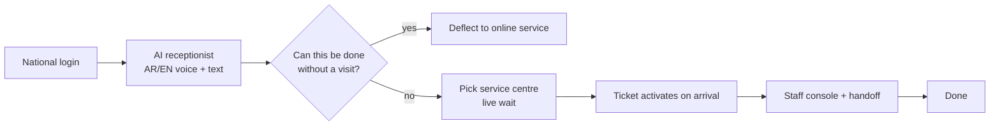

# Vision — Dawri as a platform

**Dawri = "my turn".** The name fits any place in Qatar where people queue for a government service. Health centres are the first vertical. The same core can serve other government service centres, each with its own flow.

## What stays the same in every vertical (the core)

- Arrival-activated queue engine ([[Queue Engine]])
- AI intake that turns free speech into a structured request
- Deflection: "you don't need to come — do it online here"
- Staff console + waiting-room display

## What changes per vertical (the "different ways")
| Vertical | Intake the AI collects | Deflection example | Special rules |
|---|---|---|---|
| **Health centres (PHCC)** — *now* | Symptoms, duration, severity | Medication refill line | Emergency red flags, nurse triage |
| Other government service centres | Which transaction, which documents the person has | Transaction already available online | Document checklist before arrival |
| Municipal / utility service centres | Request type, reference numbers | Online request/complaint form | — |
| Banks / private sector (later) | Service type | In-app transaction | — |

Each vertical = a **config pack**: intake questions, service list, deflection rules, safety rules, ticket prefixes. The core doesn't change.

## Roadmap (for the last pitch slide)
1. **Weekend:** PHCC health-centre demo.
2. **Pilot:** one PHCC centre; measure desk time saved and released no-shows.
3. **Platform:** the same core for a second government service, as a new config pack.

> Pitch line: *"Today it's your turn at the health centre. Tomorrow, anywhere in Qatar you take a number."*

⚠ Keep the weekend demo 100% health. Mention the platform in **one** slide at the end, not in the demo.
