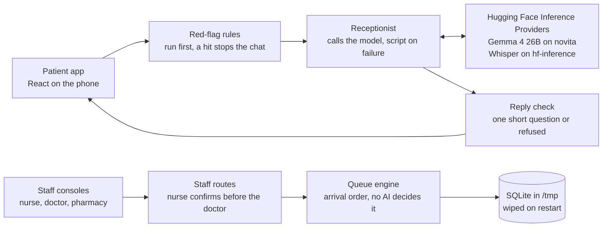

# Dawri Team Handoff

Written on 7 November 2026 at about 07:05 Doha, by the project owner with Claude.

## Start here

Dawri is built, tested and live on a public Hugging Face Space, and the code is merged to `main`. **Submission is due at 14:00 Doha today, Saturday 7 November 2026, and that deadline is firm.** What remains is real-phone testing, human review of the Arabic and red-flag list, a rehearsal and the submission itself. This document was written at about 07:05 Doha.

| What | Where |
| --- | --- |
| Live app, best for phones | [xtamim-dawri.hf.space](https://xtamim-dawri.hf.space) |
| Staff consoles | [xtamim-dawri.hf.space/staff](https://xtamim-dawri.hf.space/staff) |
| Space page | [huggingface.co/spaces/xTamim/dawri](https://huggingface.co/spaces/xTamim/dawri) |
| Code, private repo | [github.com/Jaber-ja2314817/Dawri](https://github.com/Jaber-ja2314817/Dawri), branch `main` |
| This handoff, editable copy | [Dawri Team Handoff doc](https://claude.ai/artifact/MAcmRysbCiXA53eu21fQPS) |
| Specification | `Dawri-Vault/` in the repo. Start with `00 Home.md` |
| Decisions that override older notes | `Dawri-Vault/07 Build/Build Decisions.md` |
| Full build evidence | `Dawri-Vault/07 Build/Orchestrator Log.md` |

**Do these first:**

1. Ask the project owner for the Reset passcode. It is deliberately not in this document. You need it for the Reset demo button.
2. Ask the owner for GitHub access if you need the code. The repo is private. If the submission needs a code link, the owner must decide whether to make it public.
3. Open the live app on your own phone and run one visit.
4. Work through "What is left" below.

**Hard rules:** never paste the Hugging Face token into chat, a document or code, and use only synthetic patient data. The red-flag list has not been reviewed by a clinician, so never claim that it has.

## What Dawri is

Dawri (دوري, "my turn") is an AI front desk for Qatar's PHCC primary health centres, built for the Qai × Hugging Face Hackathon in Doha. The brief: build an AI system that solves a real problem in Qatar, using open-source tools on Hugging Face, and submit it as a live demo.

A patient checks in from their phone. An AI receptionist asks short questions in Arabic or English, by text or voice, and rules screen every message for emergencies. The patient reserves a place at a centre, activates a ticket on arrival, and goes to the nurse without queuing at reception.

The AI never diagnoses or prescribes. It collects information, and a nurse confirms everything before the doctor sees it.

| Demo patient | Login QID | Scenario | What should happen |
| --- | --- | --- | --- |
| Fatima Al-Demo, 34 | `DEMO-10001` | Normal visit, Arabic. Penicillin allergy | Intake, ticket T-014 on a fresh reset, nurse, doctor, pharmacy, done. Amoxicillin triggers the allergy warning |
| Ahmed Al-Demo, 67 | `DEMO-10002` | Asks for his usual blood pressure pills | Refill route offered, with no ticket |
| Ravi Demo | `DEMO-10003` | English, chest pain spreading to the arm | Emergency screen, 999 and the nearest hospital, with no ticket |

The demo login OTP is `0000`. The app has one-tap quick-pick chips for these patients. All patients, staff and records are synthetic, and the app states that it is not connected to PHCC or HMC systems.

## What is left

Four human jobs remain before the 14:00 submission: test on a real phone, review the wording, rehearse, and submit. No build work is required unless testing finds a problem. Stop changing code at 12:00.

**By 11:00: test and review**

- [ ] Open the live app on a real iPhone and a real Android phone, using the direct `hf.space` link.
- [ ] Try voice input, then confirm the transcript. A real microphone has never been tested.
- [ ] Allow location and try "I'm here". A real geolocation check has never been tested.
- [ ] Run Fatima, Ahmed and Ravi in both Arabic and English.
- [ ] Open a staff console beside the patient view and confirm live updates.
- [ ] Have a Qatari speaker read the Arabic, especially `شو اللي يتعبك`.
- [ ] Ask a clinician to look at the red-flag list and the 13 new wordings. If nobody is available, say so plainly to judges.

**11:00 to 12:00: last fixes**

- [ ] Send any bugs to the owner or Claude. Fix only what would hurt the demo.
- [ ] Redeploy if code changed, then retest. See the Deployment section.

**12:00 to 13:30: rehearse and write up**

- [ ] Stop code changes at 12:00.
- [ ] Do two timed run-throughs with a real person. The 148-second result came from an automated script, not a human.
- [ ] Record a backup video in case of venue Wi-Fi or provider failure.
- [ ] Write the submission text. Use the honest answers at the end of this document.
- [ ] Decide whether the GitHub repo must be public for the submission.

**13:30 to 14:00: submit**

- [ ] Press Reset demo with the passcode, and check `/api/health` says `ai_mode` is `real`.
- [ ] Submit the live link by 13:30, which leaves 30 minutes spare.

**After the hackathon**

- [ ] Delete the Hugging Face token and any copy of it.
- [ ] Stop or delete the paid Space.
- [ ] Delete the private `xTamim/jobs-artifacts` bucket if nobody needs it.

## The story from A to Z

Dawri went from a written specification to a public deployment in about 30 hours of build time, using Claude agents coordinated by an orchestrator. One agent planned each phase from the vault, builders wrote the code, and an independent reviewer had to approve it before commit. Every phase passed its review, but several needed repeat rounds.

| When (Doha) | What happened | Commit |
| --- | --- | --- |
| Thu 5 Nov, day | Idea, research and specification written in the Obsidian vault | `a2ac73a` |
| Thu 5 Nov, 21:00 | Vault reviewed. 10 problems found. Fanar 27B turned out to have no provider | none |
| Fri 6 Nov, 00:30 | Orchestrated build started on branch `build/dawri-app`. `Build Decisions.md` written to override older notes | none |
| Fri 6 Nov, 01:06 | **Phase 1, Foundation:** database, seeds, login, queue engine, live events | `d0521fc` |
| Fri 6 Nov, 11:20 | **Phase 2, AI layer:** red flags, model adapter, scripted receptionist, intake, handoff. Hardest phase, with repeated review rounds overnight | `629d522` |
| Fri 6 Nov, 15:06 | **Phase 3, API:** every patient, staff and demo route. Approved in round 4 | `5df531c` |
| Fri 6 Nov, 17:25 | Paused for a restart. Phase 4 saved unreviewed | `cb61c24` |
| Fri 6 Nov, 17:57 | **Phase 4, Patient app:** screens S01 to S12. Approved in round 1 | `0dcc28e` |
| Fri 6 Nov, 21:03 | **Phase 5, Staff consoles:** screens T01 to T09. Approved in round 2 | `dd4fc93` |
| Sat 7 Nov, 03:00 to 04:30 | Token set up. Live model tests found Fanar unavailable and picked Gemma 4 26B | none |
| Sat 7 Nov, 04:30 to 05:51 | Fanar 9B fine-tuned on Hugging Face Jobs | none, repos on `xTamim` |
| Sat 7 Nov, 05:05 | **Phase 6, Integration:** Docker, README, end-to-end tests. Approved in round 4 | `311c6d4` |
| Sat 7 Nov, 05:09 | Gemma 4 26B made the default model | `8993f8f` |
| Sat 7 Nov, 06:29 | 13 missed emergency wordings added. Safety check widened for normal phrasing | `7374ee1` |
| Sat 7 Nov, 06:38 | Reset passcode added. Arabic handoff fixed | `8271132` |
| Sat 7 Nov, 06:45 | Space deployed privately and tested live | `8abcead` |
| Sat 7 Nov, 07:00 | Space made public. Merged to `main` | `ce3addf` |

**Decisions that shaped the build:**

- **Simulated mode exists.** A scripted receptionist runs without a token, and takes over a turn if the model fails. It is labelled, never passed off as AI.
- **Safety rests on structure, not word lists.** A model reply reaches a patient only if it is one short plain question. Rules run before the model, and the model can never clear a rule hit.
- **The nurse always sees the patient's exact words,** next to any AI summary.
- **A reserved ticket has no number and no place.** Order comes from arrival, so never say "place held".
- **Simulated queue load never blocks a real patient.** Fake tickets count toward waits and clear automatically when a real ticket is next.
- **No no-show claims.** The vault's statistic covers appointments, while Dawri handles walk-ins.
- **Fanar 27B, MedGemma and text-to-speech were dropped,** and the owner later moved the live chat from Fanar to Gemma after testing.
- **English is the priority for live AI.** Arabic works, with a scripted fallback for replies the safety check rejects.

## Architecture and repo map

Dawri is one FastAPI process that serves the React app and the API from a single Docker container, with SQLite for data. Models run outside it, through Hugging Face.



A chat message passes the rules before any model call, and a reply reaches the patient only if it passes the reply check. Staff steps run through the queue engine, which the AI cannot touch.

The stack is Python with FastAPI and Pydantic, and SQLite. The frontend uses React 19, Vite 8, TypeScript, Tailwind 4 and Leaflet with OpenStreetMap. Tests use pytest, Vitest and Playwright. Live updates use server-sent events, with polling as a fallback.

| Path | What it holds |
| --- | --- |
| `backend/main.py` | App start-up, background loops, frontend serving |
| `backend/config.py` | All environment settings and model defaults |
| `backend/queue_engine.py` | Ticket lifecycle and ordering. No AI touches it |
| `backend/visit_flow.py` | Nurse, doctor and pharmacy steps, allergy checks |
| `backend/routers/` | `auth`, `visits`, `staff`, `centres`, `streams`, `demo` |
| `backend/ai/redflags.py` | Emergency rules. Add new wordings here, and add tests |
| `backend/ai/filters.py` | The reply safety check, `gate_reply` |
| `backend/ai/receptionist.py` | One chat turn: rules, model, checks, fallback |
| `backend/ai/simulated.py` | The scripted receptionist |
| `backend/ai/handoff.py` | Nurse handoff text, including the Arabic version |
| `backend/seed/` | Synthetic patients, staff, centres, drugs |
| `backend/tests/` | Backend test suite |
| `frontend/src/pages/patient/` | Patient screens S01 to S12 |
| `frontend/src/pages/staff/` | Staff screens T01 to T09 |
| `frontend/src/i18n/` | Arabic and English text |
| `frontend/e2e/` | Playwright browser tests |
| `Dockerfile`, `.dockerignore` | The image. Non-root, port 7860 |
| `README.md` | Space card and setup guide |
| `Dawri-Vault/` | Product spec, decisions and build log. Not uploaded to the Space |

The vault has more detail. See `03 Product` for screens and features, `04 AI` for guardrails, `05 Architecture` for the API and data model, and `06 Hackathon` for the pitch, demo script and judge Q&A. Where those disagree with `07 Build/Build Decisions.md`, Build Decisions wins.

## AI models

The live app uses Gemma 4 26B on novita for chat and Whisper large-v3-turbo on hf-inference for voice. Gemma won a live test of 16 model and provider pairs, run through the app's real prompt and safety check. All of it runs through Hugging Face Inference Providers on the `xTamim` account.

| Job | Model | Provider | Status |
| --- | --- | --- | --- |
| Chat, intake, handoff draft | `google/gemma-4-26B-A4B-it` | `novita` | Live, default |
| Chat backup | `meta-llama/Llama-3.3-70B-Instruct` | `ovhcloud` | Tested, not active |
| Speech to text | `openai/whisper-large-v3-turbo` | `hf-inference` | Live, default |

**Live test results, 7 November.** Each pair had 3 availability calls and 3 short chats, or 4 calls and 2 chats in the first Llama and Fanar run. "Questions passing" was measured before the safety check was widened, so today's rate is higher. This is a small sample.

| Model and provider | Calls that worked | Questions passing safety check | Intake from model | Slowest call | Verdict |
| --- | --- | --- | --- | --- | --- |
| Gemma 4 26B, novita | 3 of 3 | 5 of 11 | 3 of 3 chats | 4.3 s | Picked |
| Llama 3.3 70B, novita | 3 of 3 | 1 of 9 | 3 of 3, with a retry | 4.2 s | Runner-up |
| gpt-oss 120B, groq | 3 of 3 | 3 of 14 | 1 of 3 | 2.0 s | Fast, drifted into Arabic |
| Gemma 4 31B, novita | 3 of 3 | 3 of 12 | 3 of 3 | 8.0 s | Slower |
| gpt-oss 120B, cerebras | 3 of 3 | 2 of 14 | 1 of 3 | 0.8 s | Fastest, same drift |
| Qwen 3.8 27B, cerebras | 3 of 3 | 2 of 14 | 0 of 3 | 1.1 s | Intake failed |
| Fanar 9B, featherless-ai | 0 of 8 | none | none | none | At capacity |
| SILMA 9B, featherless-ai | 0 of 4 | none | none | none | At capacity |

Also rejected: GLM 4.7 Flash and Qwen 3.8 on novita and Qwen 3.5 9B were too slow, at up to 30 s. gpt-oss 20B on groq errored on most calls. Granite and Apertus passed few questions. Scaleway and Together returned 402 for pay-as-you-go. Llama on featherless was too slow for the 10-second limit.

**Emergency test:** Gemma escalated 13 of 13 serious wordings on its own, in English and Arabic.

**Why not Fanar:** it is Qatar-built and fits the pitch, but its only provider refused every call, with 0 of 8 working. The Qatar story survives only through the fine-tuning work below, so do not claim the live app runs on Fanar.

**To switch model,** set `LLM_MODEL_ID` and `LLM_PROVIDER` as Space variables. No code change is needed. Check `/api/health` afterwards. Gemma and Llama have the same call shape, but a new model should be retested through the safety check.

If the model fails or times out at 10 seconds, the scripted receptionist answers that turn and the event log records `ai.fallback`.

## Fine-tuning

Fanar 9B was fine-tuned and the result is published privately, but **it must stay out of live chat because it stopped recognising emergencies.** It is a results-only demo. Figures in this section come from the training agent's report and were not independently rechecked.

| Measure | Fanar base | Fanar tuned |
| --- | --- | --- |
| Questions passing the safety check, English | 1 of 50 | 50 of 50 |
| Questions passing the safety check, Arabic | 0 of 50 | 50 of 50 |
| Valid intake, English | 4 of 27 | 25 of 27 |
| Valid intake, Arabic | 2 of 36 | 31 of 36 |
| Asked the right next topic | 0 of 100 | 89 of 100 |
| **Recognised an emergency** | **9 of 13** | **0 of 13** |

- **Method:** a LoRA adapter on `QCRI/Fanar-1-9B-Instruct`, 1.5 epochs on synthetic conversations from the scripted receptionist, on an A10G large GPU through Hugging Face Jobs.
- **Cost:** 77.6 GPU minutes, about $1.96 calculated from list prices. Actual billing was not readable with this token.
- **Adapter:** [xTamim/dawri-fanar-9b-lora](https://huggingface.co/xTamim/dawri-fanar-9b-lora), private.
- **Dataset, scripts and raw results:** [xTamim/dawri-intake-synth](https://huggingface.co/datasets/xTamim/dawri-intake-synth), private.

**How to describe it honestly:** it learned the format and mostly imitates the script, using only 14 different questions in the 100 tested. The emergency failure happened because the training data had no emergencies. No diagnosis or dose appeared in 20 tricky prompts, though the app's safety check already blocked those for the base model too.

**Why it is not live:** beyond the emergency result, it has no provider, so it needs its own GPU. Its intake took 13 to 17 seconds, over the app's 10-second limit. About 5 of 56 accepted intakes also had a clearly wrong complaint, by an unreviewed manual reading.

Fine-tuning was thought to be required, but the public hackathon page does not mention it, and nobody has confirmed that with an organiser. A second run with emergency examples would take about 65 minutes and $1.60, and it was left out of the final plan.

## Deployment

The app runs as one Docker container on the public Space `xTamim/dawri`, on the `cpu-upgrade` tier at about $0.03 an hour. Hugging Face requires PRO for Docker Spaces on the free CPU tier, and `xTamim` is a normal user account without PRO. The account had $99.98 of credit on 7 November, before the small model and hosting costs.

| Setting | Where | Value |
| --- | --- | --- |
| `HF_TOKEN` | Space secret | Write-preset fine-grained token named `dawri-ai`, with Inference Providers and Jobs added. Never shown |
| `DEMO_PASSCODE` | Space secret | Ask the owner |
| `LLM_MODEL_ID`, `LLM_PROVIDER` | Code defaults | Gemma 4 26B, novita |
| `ASR_MODEL_ID`, `ASR_PROVIDER` | Code defaults | Whisper large-v3-turbo, hf-inference |
| `DAWRI_DB` | Dockerfile | `/tmp/dawri.db` |
| `SIMULATE_LOAD` | Dockerfile | `1` |

**The database is temporary.** It lives in `/tmp`, so a Space restart wipes visits and reseeds. Press Reset before presenting anyway.

**To redeploy after a code change,** commit first, then upload a clean copy of that commit, never your working folder. This keeps `.env` and the vault out of the public Space:

```bash
D=$(mktemp -d)
git archive HEAD | tar -x -C "$D"
rm -rf "$D/Dawri-Vault"
HF_TOKEN=<token> .venv/bin/python -c "import sys; from huggingface_hub import HfApi; HfApi().upload_folder(repo_id='xTamim/dawri', repo_type='space', folder_path=sys.argv[1], commit_message='Update Dawri')" "$D"
```

The Space rebuilds automatically, which took about 1 minute last time. Then check `/api/health` and run one chat. If real mode misbehaves, remove the `HF_TOKEN` secret in the Space settings and restart. The app then runs in labelled simulated mode.

**GitHub:** `build/dawri-app` was merged into `main` at `ce3addf` by fast-forward, so there is no merge commit. The repo is private.

**The Space is public, so anyone can use it,** and every chat turn spends a little `xTamim` credit. Staff login has no password. Reset needs the passcode, but anyone can open the consoles and move tickets. Keep an eye on the credit balance at [huggingface.co/settings/billing](https://huggingface.co/settings/billing).

**A smaller token is safer.** The Space does not need write access to run. A new token with only Inference Providers would limit the damage if the secret ever leaked.

## Running and testing

The last full test pass was all green on the code now live. Only the notes changed after it. The Space upload came from commit `8271132`, so its README lacks the last status notes, but its app code is final.

| Check | Result |
| --- | --- |
| Backend tests, Python 3.14 | 10,774 passed |
| Frontend unit tests | 573 passed |
| Browser tests, local build | 178 passed |
| Browser tests, inside Docker | 175 passed, stand-in model specs excluded |
| Docker checks | 9 of 9 passed |
| Passcode screen in real Chrome | Passed, with wrong and right codes |
| Live on the Space | Chat, Whisper, overdose wording, passcode and event stream all worked |

**Run it locally.** Python 3.12 or later, Node 22 and Chrome are needed:

```bash
python3 -m venv .venv
.venv/bin/pip install -r requirements-dev.txt
cd frontend && npm ci && npm run build && cd ..
HF_TOKEN= SIMULATE_LOAD=1 .venv/bin/uvicorn backend.main:app --port 7860
```

Then open [localhost:7860](http://localhost:7860). `HF_TOKEN=` set to blank keeps it in simulated mode. Leave that out with a real token in `.env` and the server runs in real mode and spends credit. Copy `.env.example` to `.env` if you need one. `.env` is gitignored.

**Run the tests:**

```bash
.venv/bin/python -m pytest -q
cd frontend
npm run typecheck
npm run test
npm run e2e
```

The browser tests take about 8 minutes. Keep Chrome open if it appears in the Dock, because quitting it during a run breaks the run. To test the image, build it with `docker build -t dawri:local .`, then run `bash frontend/scripts/docker-check.sh dawri:local` and `bash frontend/scripts/e2e-container.sh dawri:local`.

**Demo-day checklist:**

- [ ] Press Reset demo with the passcode just before presenting.
- [ ] Send one chat 2 minutes before, to warm up the model path.
- [ ] Keep the backup video ready.
- [ ] If voice fails, type the same sentence.
- [ ] If a normal visit is flagged as an emergency, reset and run it again.
- [ ] On phones, use the direct `hf.space` link, not the embedded Space page.

## Known gaps and honest answers

Dawri is a credible prototype, not a clinical product, and judges will trust it more if you say so first. The biggest open items are the unreviewed safety rules, and no test yet on a real phone.

| Gap | Impact | What to do |
| --- | --- | --- |
| Red-flag list and drug regimens not clinically reviewed | Could miss or over-flag | Get a review, or say it plainly |
| Real phone, microphone, iOS Safari and geolocation untested | Voice or arrival may fail in front of judges | Test before 11:00. Fall back to typing and the I'm here button |
| Gemma false emergency, 1 in 16 reruns of one chat | Interrupts the demo | Reset and rerun. It fails in the safe direction |
| Arabic replies partly scripted | Some turns are not live AI | Say so. English is the live-AI priority. A stomach-pain Arabic chat was mostly scripted, while a cough chat was mostly live |
| Arabic not checked by a Qatari speaker | May read as unnatural | Review on the live app |
| Reset on a public Space | Protected by passcode, but consoles are open | Keep the passcode private |
| Simulated scale | SQLite, one process, data wiped on restart | Demo only. Never run a second worker |
| Small model test samples | Tests used small samples | Do not quote pass rates as proven accuracy |
| Small UI items | Listed in the Orchestrator Log | Fix only if they hurt the demo |

**Honest answers for judges:**

- **Does the AI diagnose?** No. Rules check every message first, the reply check allows only one short plain question, and a nurse confirms everything.
- **Which model runs it?** Gemma 4 26B through Hugging Face Inference Providers, with Whisper for voice. It was chosen by live testing.
- **Why not Fanar?** We wanted to. Its only provider had no capacity, with 0 of 8 calls working. We fine-tuned Fanar 9B separately, and that is a results-only demo.
- **Did fine-tuning work?** It hit its format goal: 100 of 100 questions passed, up from 1 of 100. It also lost emergency recognition, 0 of 13 against 9 of 13, so we kept it out of live chat. Showing that decision is a strength.
- **What is real and what is simulated?** Patients, staff, records and queue load are synthetic. The AI calls are real in the live app. If the model fails, the scripted receptionist takes over and the app labels it.
- **Does this save time?** Not proven. There is no measured desk-time data yet. Only the reception queue is removed, not triage, doctor or pharmacy.
- **Is it ready for real patients?** No. It would need MoPH, PHCC and HMC partnership, national authentication, a clinical review and data-protection approval.

Do not claim that nobody skips the queue, that a place is held, or that no-shows fall. Do not claim clinical validation or real PHCC integration.
